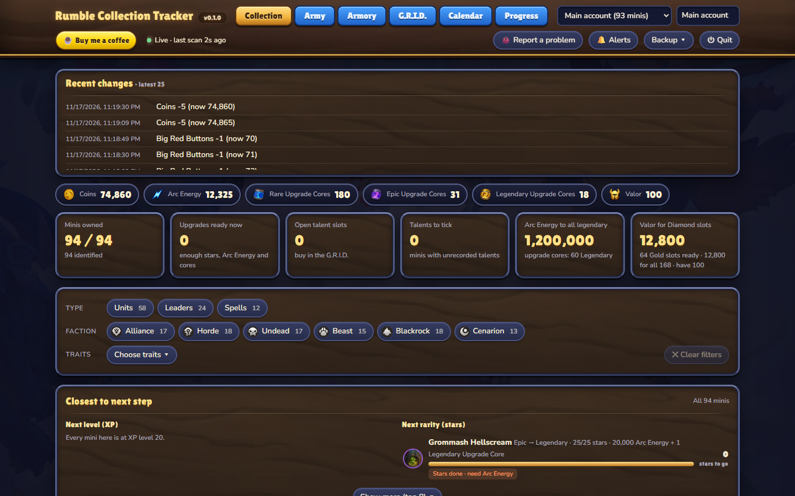
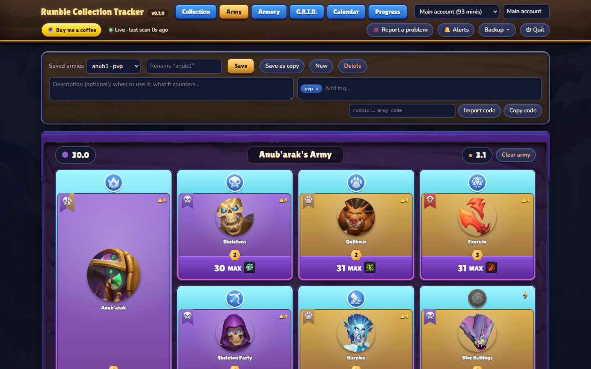
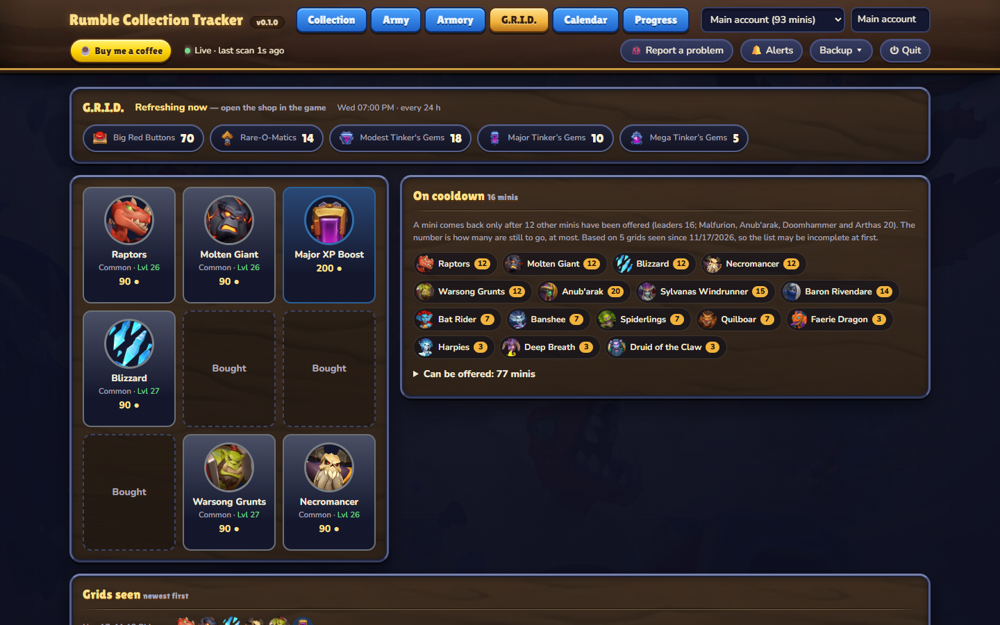
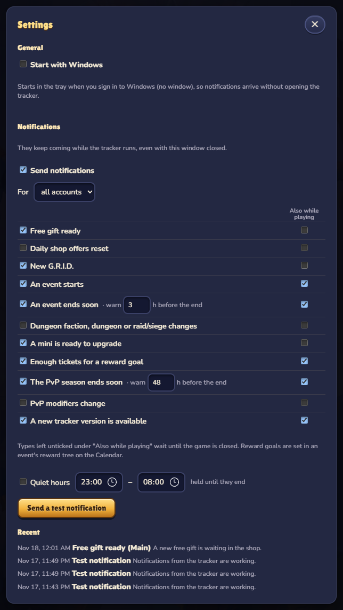
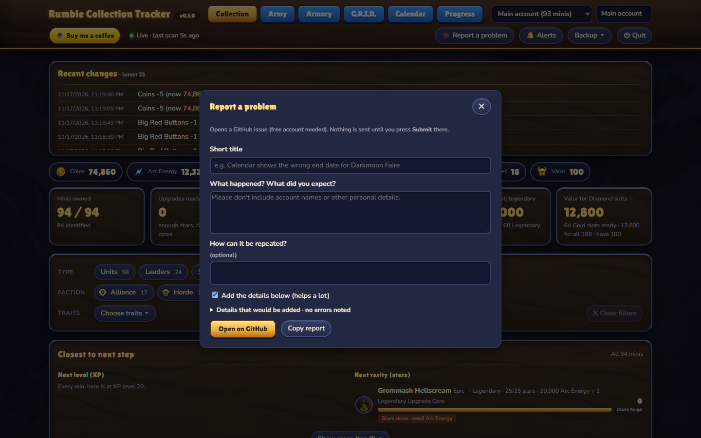

# Player guide

How to use the Rumble Collection Tracker: what each tab shows and what you can do there. To install it, see the
[README](../README.md).

While the game runs, the tracker reads your progress from the game's saved data on your PC every few seconds. Play a
battle, upgrade a mini or buy something, and it shows up within a few seconds. You don't need to keep the window in
front of you, since the tracker keeps running in the tray and the window catches up whenever you open it. What happens
in the background (reading the save, backups, updates) is explained in [How the tracker works](HOW-IT-WORKS.md).

- [The top bar](#the-top-bar)
- [Collection](#collection)
- [Army](#army)
- [Armory](#armory)
- [G.R.I.D.](#grid)
- [Calendar](#calendar)
- [PvP](#pvp)
- [Progress](#progress)
- [Settings](#settings)
- [Report a problem](#report-a-problem)
- [Backup](#backup)
- [Tips](#tips)

## The top bar

The top bar stays visible on every tab. Its first row has the tabs and, on the right, the account. If more than one
Warcraft Rumble account has played on this PC, pick one there, and type a name in the box next to it (such as "Main")
to tell them apart. The name stays on your PC.

The second row holds the status and the buttons:

| | |
|---|---|
| Status | *Live · last scan 5s ago* means the tracker is reading your save. *Game closed* means Warcraft Rumble isn't running, so the save can't change and the tracker waits for the game to start. Anything else is covered in [Tips](#tips). |
| **⚙ Settings** | Start with Windows and notifications ([below](#settings)) |
| **🐞 Report a problem** | Tell us about a bug ([below](#report-a-problem)). A red dot means the tracker noticed an error. |
| **Backup** | Save or restore everything you entered ([below](#backup)) |
| **⏻ Quit** | Stops the tracker. Closing the window doesn't; the tracker keeps running in the tray, so notifications still arrive. |

## Collection

Your whole collection at a glance. **Recent changes** at the top lists XP gained, upgrades and currency changes as
they happen, newest first; scroll inside the box for older ones, up to 25. Below it are your currencies as the game
saved them: coins, Arc Energy, upgrade cores and Valor. Event tickets are on the Calendar tab, and Big Red Buttons,
Rare-O-Matics and Tinker's Gems on the G.R.I.D. tab.

The summary cards count the minis you own, the upgrades you can afford right now and your open talent slots. They also
show how much Arc Energy and how many cores every mini still needs to reach legendary, and how much Valor the Diamond
slots need. **Closest to next step** picks the minis nearest to their next level and their next rarity, with what's
still missing.

Further down, filter the grid of minis by type (units, leaders, spells), faction and traits, and use *Show* (owned, or
owned + not owned) and *Sort*. Click a mini for its details: level, XP, stars and rarity, the next upgrade and its cost,
its stats at its level, traits and talents.

Two things need you now and then:

- **Talents.** The save only says *how many* talents a mini has, not which ones. Tick the ones you picked in the mini's
  details; *Talents to tick* counts the minis still waiting for that.
- **Needs your input** appears when the game has a mini the tracker can't name yet, usually a brand-new one right after
  a patch. Pick which mini it is, or wait for the next game-data update.

## Army

Build an army of a leader and six minis from your collection, and see each mini at the level it would play at in its
slot. Each slot shows the mini's level, its talent and the slot's type; the **Boost** slot gives the mini there full
XP level. The average gold cost and average level sit at the top of the board.

Save the army with *Save* or *Save as copy*, start over with *New*, and give it a description and tags such as "pvp" or
"event". *Copy code* gives the game's army code to paste into Warcraft Rumble, and *Import code* loads one, for
example from a friend or a guide. The army you're editing is kept automatically, even if you close the window.

## Armory

All your saved armies as cards, with their leader, minis and levels. Search by name, description, tag or mini, or click
a tag to filter. Names, descriptions and tags can be edited right on the card. **Edit** opens the army on the Army tab,
and **Copy code** copies its army code.

## G.R.I.D.

The G.R.I.D. shop from your save: when it refreshes, your Big Red Buttons, Rare-O-Matics and Tinker's Gems, and the
current 3×3 grid with prices, your level of each mini and what you've bought.

The game won't offer a mini again until a number of other minis have been offered: 12 for minis, more for leaders.
**On cooldown** shows, on each mini, how many more must show up first. The tracker works this out from the grids it
has seen, so the list gets more complete the longer it runs. **Can be offered** lists the minis that can show up next,
and **Grids seen** every grid the tracker has recorded.

## Calendar

Events and the shop.

The game has three ticket balances that events take turns using. **Event tickets** at the top names each after the
event using it now and lists the events that use it next. Tickets reset when an event ends, so a balance no event is
using shows as –.

**Running now** lists the events the game says are on, with how long they last and your tickets. Open an event's
**reward tree** to see what each step costs, and pick rewards to see the cheapest way to them. Set one as a **reward
goal** and the tracker can notify you when you have enough tickets. **Shop offers** has today's daily offers and the
special offers from your save, with prices and when they reset.

Further down:

1. **Coming up**, the next events.
2. A **timeline** of 35 days with today in the middle. Drag the slider above it to look up to 4 months back or ahead;
   *Today* brings it back.
3. **Dungeons, raids & sieges** and **How events repeat**.

## PvP

The PvP season, your rank and your matches. **Rank** shows your honor and how much is left to the next rank;
**Season** has the end date and the maps; **Modifiers** the three in play now and the next ones (they change every 3
days).

**Wins / losses** has this season's record, today's and your current streak. The game doesn't save match results, so
the tracker works them out from changes in honor and Victory Points. Matches played while it isn't running still
count once it sees the change. A result is marked *estimated* when a change fits more than one combination of wins and
losses. When no combination explains a change, it is listed as *unexplained* under **Honor this season**, where you
can mark it as a *Win* or a *Loss* yourself (*Undo* takes that back).

**Win rate** shows your record while each modifier was active. Click modifiers to see only the matches played while
all of them were active, and *Show all* to clear the choice; the record and the chart follow.

Victory Road gets two panels. One shows your Victory Points and the next reward: every finished match adds some, a
win more. The other, at the bottom, lists every reward and the points it needs. Victory Road resets when the season
ends, so claim its rewards in the game before then. **Season-end rewards** shows what your current rank pays when
the season ends, and what the next rank would pay.

## Progress

How fast you're growing, from one point per day of history. The tab shows the coins and Arc Energy you earn per day,
the stars you put into minis and the levels you gain per week. **All minis legendary** works out what every mini you
own still needs to reach legendary and, at your current pace, when you'd be done. Charts show your income and total
level over time.

History starts the day you first run the tracker. Daily income comes from the game's own lifetime totals, so days you
play without the tracker still count. Rates appear after 12 hours, charts after two days.

## Settings

Click **⚙ Settings**.

**Start with Windows** starts the tracker in the tray when you sign in to Windows, without opening a window, so
notifications arrive without starting it yourself. It's only in `RumbleTracker.exe`.

### Notifications

Pick the Windows notifications you want: the free gift, the daily shop reset, a new G.R.I.D., events starting or
ending soon, a mini ready to upgrade, enough tickets for a reward goal, the PvP season ending (time to claim your
Victory Road rewards), new PvP modifiers and a new tracker version. Clicking one opens the tracker.

- *For* sends them for all accounts or just one.
- Types left unticked under *Also while playing* are skipped while Warcraft Rumble is running.
- During *Quiet hours*, notifications are held until the quiet hours end.

**Send a test notification** checks that Windows shows them. If nothing appears, make sure notifications for *Rumble
Collection Tracker* (or *Windows PowerShell*, when running from source) are allowed in Windows' *Settings → System →
Notifications*. Notifications only arrive while the tracker runs, and the tray is enough.

## Report a problem

Found a bug, or something's wrong or missing? Click **🐞 Report a problem**, describe it and click **Open on GitHub**.
Your browser opens a new issue, already filled in, which you check and submit there. That needs a free GitHub account;
*Copy report* copies the same text if you'd rather send it another way.

A screenshot often helps. Click **Take a screenshot** (or press **Win+Shift+S**), select an area, and paste it into the
issue on GitHub with **Ctrl+V**.

*Add the details below* includes the tracker's version, the game build, the game-data status and recent errors. User
names, account IDs and other personal details are removed, and your collection and save data are never included.
Open *Details that would be added* to see exactly what's sent.

## Backup

**Backup → Export backup** saves everything you entered into one file: account and mini names, talents, army slots,
saved armies, the army you're editing, reward goals and settings, plus the G.R.I.D., PvP and progress history.
**Import backup…** restores it, also on another PC. What the tracker reads from the game, like levels and currencies,
isn't in it, because it comes back from your save by itself.

The tracker also backs up by itself when it starts, every 24 hours and when it stops. It keeps one backup per day for
7 days, listed under **Backup → Automatic backups**; click one to restore it.

## Tips

| You see | What to do |
|---|---|
| *The game was updated to …* | Right after a patch, new events or minis may be missing or unnamed. The tracker installs updated game data by itself once it's published (it checks at start and every 6 hours). |
| *The tracker isn't responding* | The tracker was stopped. Start `RumbleTracker.exe` again. |
| A pop-up about a new version | *Download now* downloads it with a progress bar, checks it and restarts the tracker with it, keeping your data. If the new version can't start, the previous one is put back. *Later* hides the pop-up until the tracker restarts. |
| A damaged data file, under *Report a problem* | The tracker moved it aside (`<name>.corrupt-<date>` in the data folder) and started without it. Restore the last good backup from **Backup → Automatic backups**. |
| *No Rumble data found on this PC* | Start Warcraft Rumble on this PC at least once and log in. The tracker reads what the game saved here. |
| The status says the save couldn't be read | The game was usually saving at that moment, and it clears within a few seconds. If it stays, please [report it](#report-a-problem). |
| No window | Click the tracker's icon in the tray (the taskbar's notification area; click **^** if it's hidden), or start `RumbleTracker.exe` again. |
