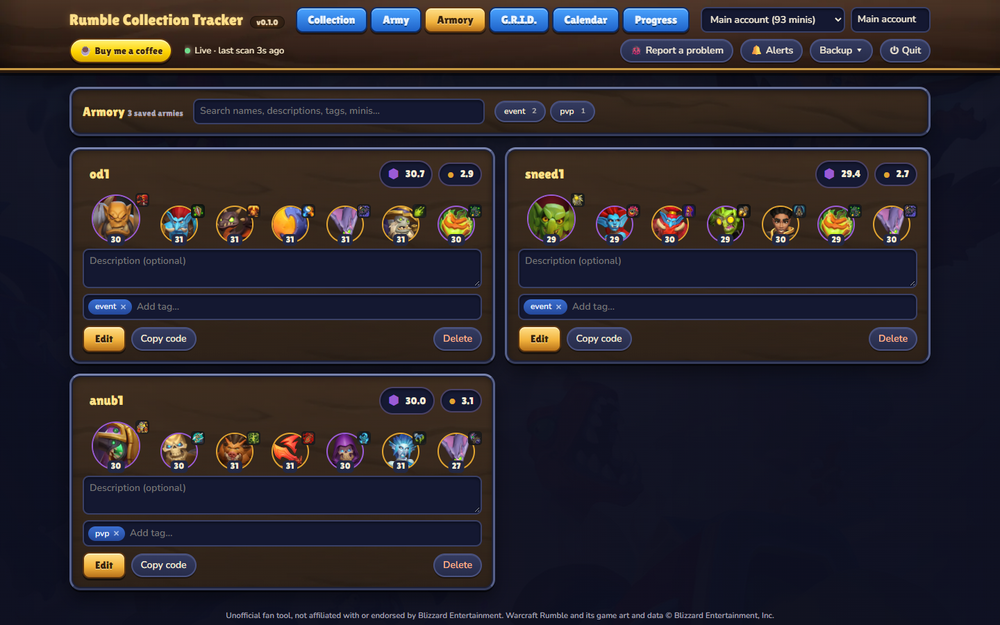
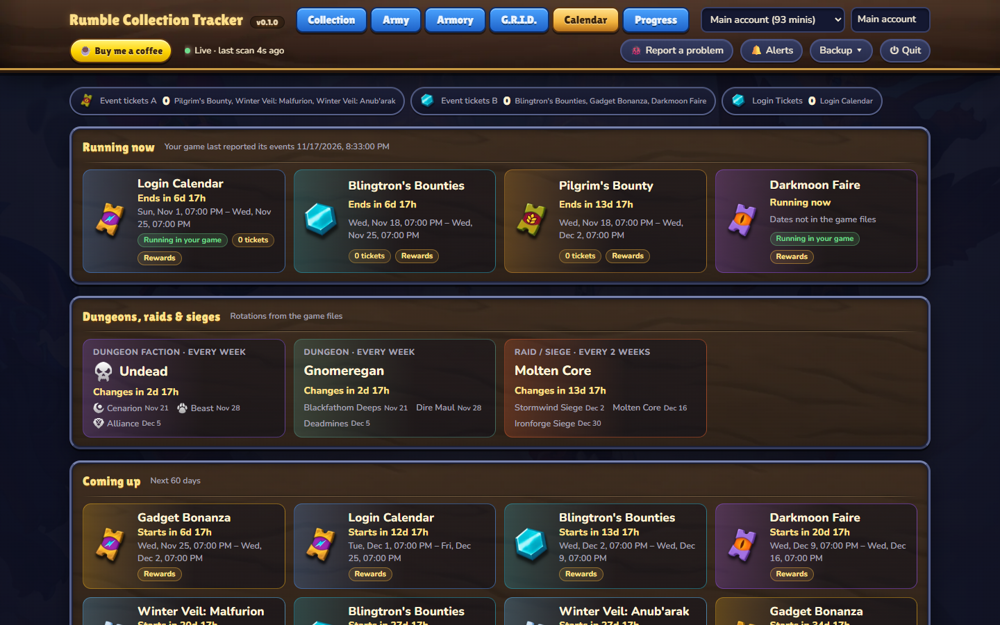
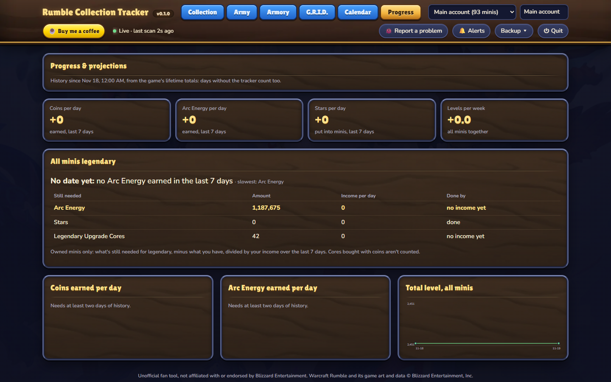
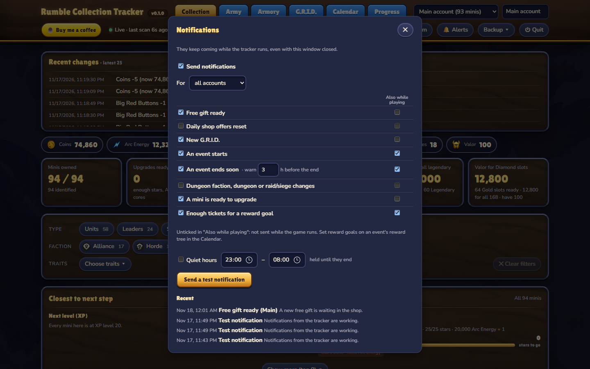

# Player guide

How to use the Rumble Collection Tracker: what each tab shows and what you can do there. To install it, see the
[README](../README.md).

The tracker reads your progress from the game's saved data on your PC every few seconds while the game runs. Play a
battle, upgrade a mini or buy something, and the tracker shows it within a few seconds. You don't need to keep it in
front of you: it keeps running in the tray, and the window updates whenever you open it. What it does in the
background (reading the save, backups, updates) is explained in [How the tracker works](HOW-IT-WORKS.md).

- [The top bar](#the-top-bar)
- [Collection](#collection)
- [Army](#army)
- [Armory](#armory)
- [G.R.I.D.](#grid)
- [Calendar](#calendar)
- [PvP](#pvp)
- [Progress](#progress)
- [Settings](#settings)
- [Report a problem](#report-a-problem)
- [Backup](#backup)
- [Tips](#tips)

## The top bar

Always visible, on every tab, in two rows. On top:

- **Tabs**: Collection, Army, Armory, G.R.I.D., Calendar, PvP, Progress.
- **Account** (top right): if more than one Warcraft Rumble account has played on this PC, pick one here. Type a name
  in the box next to it (e.g. "Main") to tell them apart; the name stays on your PC.

Below:

- **Status**: *Live · last scan Xs ago* means the tracker is reading your save. *Game closed* means Warcraft Rumble
  isn't running: the save can't change then, so the tracker pauses until the game starts. If it says something else,
  see [Tips](#tips).
- **⚙ Settings**: Start with Windows and notifications ([below](#settings)).
- **🐞 Report a problem**: tell us about a bug ([below](#report-a-problem)). A red dot on it means the tracker noticed
  an error.
- **Backup**: save or restore everything you entered ([below](#backup)).
- **⏻ Quit**: stops the tracker. Closing the window doesn't stop it; it keeps running in the tray, so notifications
  still arrive.

## Collection

Your whole collection at a glance.

- **Recent changes** (at the top): XP gained, upgrades, currency changes, as they happen; the latest 25, newest first.
  Scroll inside the box for older ones.
- **Currencies**: coins, Arc Energy, upgrade cores and Valor, as the game saved them. (Event tickets are on the
  Calendar tab; Big Red Buttons, Rare-O-Matics and Tinker's Gems on the G.R.I.D. tab.)
- **Summary cards**: how many minis you own, how many upgrades you can afford right now, open talent slots, how much Arc
  Energy and how many cores you'd still need to make every mini legendary, and how much Valor the Diamond slots need.
- **Filters**: by type (units, leaders, spells), faction and traits. Below them (scroll down) is the grid of minis,
  with *Show* (owned, or owned + not owned) and *Sort*.
- **Closest to next step**: the minis nearest to their next level and their next rarity, with what's still missing
  (stars, Arc Energy, cores).
- **Click a mini** for its details: level, XP, stars and rarity, the next upgrade and its cost, stats at its level,
  traits and talents.
- **Talents**: the save only says *how many* talents a mini has, not which ones. Tick the ones you picked in the mini's
  details; "Talents to tick" counts minis where you haven't yet.
- **Needs your input**: appears when the game has a mini the tracker can't name yet (a brand-new mini right after a
  patch). Pick which mini it is, or wait for the next game-data update.

## Army

Build an army (a leader and six minis) and see each mini at the level it would have in its slot.

- Pick a leader and minis from your collection. Each slot shows the mini's level, its talent and the slot's type; the
  bottom-right **boost slot** gives the mini there full XP level.
- Top of the board: average gold cost and average level.
- **Saved armies**: *Save*, *Save as copy*, *New*, *Delete*; add a description and tags ("pvp", "event"…).
- **Army codes**: *Copy code* gives the game's army code, to paste into Warcraft Rumble; *Import code* loads one
  (e.g. from a friend or a guide).
- The army you're editing is kept automatically, even if you close the window.

## Armory

All your saved armies as cards, with their leader, minis and levels.

- **Search** by name, description, tag or mini, or click a tag to filter.
- Edit names, descriptions and tags right on the card.
- **Edit** opens the army on the Army tab; **Copy code** copies its army code.

## G.R.I.D.

The G.R.I.D. shop from your save.

- When it refreshes, and your Big Red Buttons, Rare-O-Matics and Tinker's Gems.
- The current 3×3 grid with prices and your level of each mini, and what you've bought.
- **On cooldown**: the game won't offer a mini again until a number of other minis have been offered (12 for minis,
  more for leaders). The number on each mini is how many more must show up first. The tracker works this out from the
  grids it has seen, so the list gets more complete the longer it runs.
- **Can be offered**: the minis that can show up next.
- **Grids seen**: every grid the tracker has recorded.

## Calendar

Events and the shop.

- **Event tickets** at the top: the game has three ticket balances that events take turns using, so each is named
  after the event using it now, with the events that use it next. Tickets reset when an event ends, so a balance no
  event is using shows as –.
- **Running now**: events the game says are on, with how long they last and your tickets.
- **Rewards**: open an event's reward tree to see what each step costs. Set a **reward goal** there, and the tracker
  can notify you when you have enough tickets for it.
- **Shop offers**: today's daily offers and the special offers from your save, with prices and when they reset.
- Further down: **Coming up** (the next events), a **timeline** of 35 days with today in the middle (drag the slider
  above it to look up to 4 months back or ahead; *Today* brings it back), **Dungeons, raids & sieges** and **How events repeat**.

## PvP

The PvP season, your rank and your matches.

- **Rank**: your rank, honor and how much honor is left to the next rank.
- **Wins / losses**: this season's record, today's record and your current streak. The game doesn't save match
  results, so the tracker works them out from changes in honor and Victory Points while it runs. Matches played
  while it isn't running still count once it sees the change. Marked *estimated* when a change fits more than one
  combination of wins and losses. A change no combination explains is listed as *unexplained* under **Honor this
  season**: mark it as a *Win* or a *Loss* yourself (*Undo* takes it back).
- **Victory Road**: your Victory Points (every finished match adds some, more for a win) and the next reward.
  Victory Road resets at the end of the season, so claim the rewards in the game before then.
- **Season**: the season's end date and its maps.
- **Modifiers**: the three modifiers in play now (they change every 3 days) and the next ones.
- **Honor this season**: a chart of your honor and the latest matches.
- **Win rate**: your record while each modifier was active. Click modifiers to see only the matches played while all
  of the chosen ones were active: the record and the win-rate chart follow; *Show all* clears the choice.
- **Season-end rewards**: what your current rank pays when the season ends, and what the next rank would pay.
- **Victory Road** (bottom): every reward and how many Victory Points it needs.

## Progress

How fast you're growing, from one point per day of history.

- **Per day**: gold and Arc Energy earned, stars put into minis, levels gained per week.
- **All minis legendary**: what's still needed to make every mini you own legendary, and at your current pace, when
  you'd be done.
- **Charts** of income and total level over time.

History starts the day you first run the tracker. Daily income comes from the game's own lifetime totals, so days you
play without the tracker running still count. Rates appear after 12 hours, charts after two days.

## Settings

Click **⚙ Settings**.

**Start with Windows** starts the tracker in the tray when you sign in to Windows (no window opens), so notifications
arrive without starting it yourself. Untick it to stop that. (Only in `RumbleTracker.exe`.)

### Notifications

Choose Windows notifications: free gift ready, daily shop reset, a new G.R.I.D., an event starting or ending soon, a
mini ready to upgrade, enough tickets for a reward goal, the PvP season ending soon (claim your Victory Road rewards),
new PvP modifiers, a new tracker version, and more. Clicking a notification opens the tracker.

- **For**: all accounts or one.
- **Also while playing**: unticked notifications are skipped while Warcraft Rumble is running.
- **Quiet hours**: notifications are held until they end.
- **Send a test notification** to check that Windows shows them. If nothing appears, check that notifications for
  *Rumble Collection Tracker* (or *Windows PowerShell*, when running from source) are allowed in Windows' *Settings →
  System → Notifications*.

Notifications only arrive while the tracker is running (in the tray is enough).

## Report a problem

Found a bug, or something's wrong or missing? Click **🐞 Report a problem**, describe it and click **Open on
GitHub**. Your browser opens a new issue, already filled in; check it and press *Submit* there. A free GitHub account is
needed. *Copy report* copies the same text, if you'd rather send it another way.

To show what's wrong, add a screenshot: click **Take a screenshot** (or press **Win+Shift+S**), select an area, and
paste it into the issue on GitHub with **Ctrl+V**.

*Add the details below* adds the tracker's version, the game build, the game-data status and recent errors. User
names, account IDs and other personal details are removed, and your collection and save data are never included. Open
*Details that would be added* to see exactly what's sent.

## Backup

**Backup → Export backup** saves everything you entered into one file: account and mini names, talents, army slots,
saved armies, the army you're editing, reward goals and settings, plus the G.R.I.D., PvP and progress history.
**Import backup…** restores it, also on another PC. What the tracker reads from the game (levels, currencies…) isn't
in it: that comes back from your save by itself.

The tracker also backs up by itself: when it starts, every 24 hours and when it stops, one backup per day, kept for 7
days. **Backup → Automatic backups** lists them; click one to restore it.

## Tips

- **"Game data is older than your game"**: right after a patch, new events or minis may be missing or unnamed. The
  tracker downloads updated game data by itself (checked at start and every 6 hours) once it's published; nothing to
  install.
- **"Tracker server not reachable"**: the tracker was stopped (Quit). Start `RumbleTracker.exe` again.
- **A new version is available**: a pop-up says so. *Download now* downloads it (with progress), checks it and
  restarts the tracker with it; your data is kept. If the new version can't start, the previous one is put back.
  *Later* hides it until the tracker restarts.
- **A data file was damaged** (shown under *Report a problem*): the tracker moved it aside (`<name>.corrupt-<date>` in
  the data folder) and started without it. Restore the last good backup from **Backup → Automatic backups**.
- **"No Rumble data found on this PC"**: start Warcraft Rumble on this PC at least once, and log in. The tracker reads what
  the game saved on this PC.
- **The status says the save couldn't be read**: usually the game was saving at that moment; it clears itself within a
  few seconds. If it stays, please [report it](#report-a-problem).
- **Where's the window?** Click the tracker's icon in the tray (the taskbar's notification area; click **^** if it's
  hidden), or start `RumbleTracker.exe` again.
- **Start it with Windows**: tick *Start with Windows* in **⚙ Settings**.
